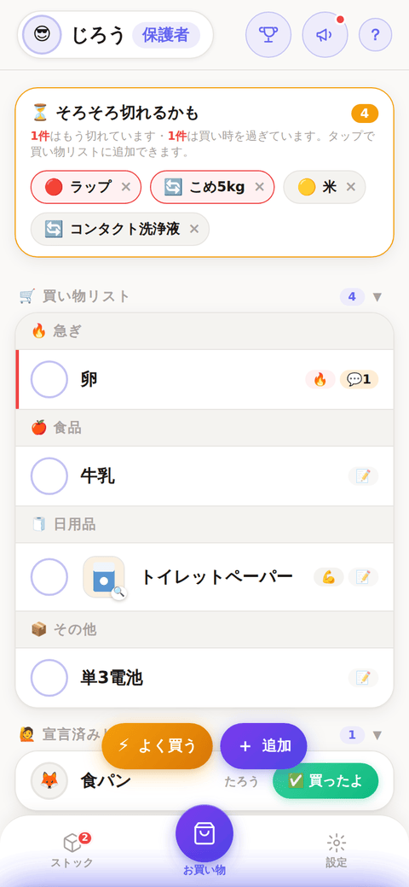
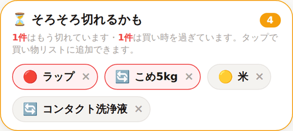

# おうちのおつかい

家族で買い物を共有するスマホアプリです。「あれ買ってきて」を家族みんなのリストにまとめて、誰が何を買うかを迷わず決められます。

## 公開URL

- 紹介ページ: https://otsukai.birdman-studio.com/
- アプリ: https://otsukai.birdman-studio.com/app.html

Safari / Chrome で開いて「ホーム画面に追加」するとアプリとして使えます。

## スクリーンショット

その他のスクリーンショットは [docs/screenshots/](docs/screenshots/) と [機能ガイド](docs/features.md) を参照してください。

## 主要機能

- **基本の流れ**: 家族の誰かが買ってほしいものを追加し、買いに行ける人が「買うよ」と宣言して、買えたら「買ったよ」で完了。完了するとポイントがもらえ、家族から「ありがとう」が届きます
- **そろそろ切れるかも（買い忘れ防止）**: ストックで「切れた」「残り少ない」と記録したものと、買い物履歴から学習した購入間隔をもとに、買い忘れそうなものを先回りして知らせます。タップするだけで買い物リストに追加できます
- **お買い物タブ**: 品名とカテゴリ（食品・日用品・その他）で追加。写真、行き先、手間、急ぎ、予算、ブランド、メモ、担当者の指定ができます
- **よく買うもの**: 定番品を登録しておくと、タップして確認するだけでリストに追加できます。ストックとも自動で連動します
- **支出・家計**: 完了した買い物の金額や、その他の支出を記録して集計できます。レシート写真からの金額読み取り（端末内OCR）にも対応します
- **購入完了済み履歴**: 完了した買い物が日付ごとに残ります。「ありがとう」を送ったり、金額を記録したり、リストに戻したりできます
- **ミッション・ごほうび・ポイント**: おつかい完了でポイントが貯まり、保護者が登録した「ごほうび」と交換できます。ウィークリーミッションや、家族からのミッションもあります
- **ストックタブ**: 家にある物の残量を「たっぷり／残り少ない／切れてる」で記録する場所です。「そろそろ切れるかも」の根拠になります
- **設定・通知**: お店の登録、知らせる時期の設定、通知など

詳しい機能仕様は [docs/features.md](docs/features.md) を参照してください。

## ドキュメント

- [機能ガイド（docs/features.md）](docs/features.md) — 開発者向けの機能仕様（全13章・スクショ付き）
- [使い方ガイド](https://otsukai.birdman-studio.com/guide.html) — 利用者向けページ
- [索引（docs/index.md）](docs/index.md) — どこに何があるか、正本レジストリ
- [DBスキーマ早見表（docs/db-schema.md）](docs/db-schema.md)
- [リリース計画（docs/release-plan.md）](docs/release-plan.md)
- [CLAUDE.md](CLAUDE.md) — 開発時の読む順番・ルール
